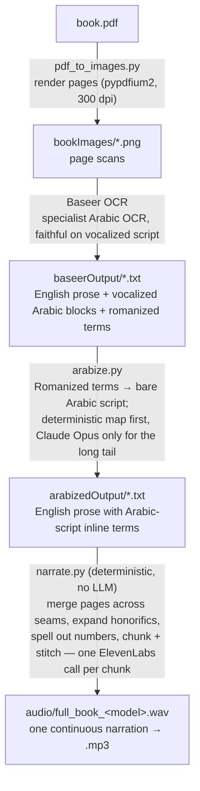

# audiobook-render


Turn any bilingual Arabic / English book — a PDF or a folder of page scans — into
a smooth, single-voice audiobook. Battle-tested on the hardest input there is:
academic texts with heavy transliteration, fully vocalized Arabic quotation
blocks, and inline honorific glyphs — the things that trip up naive OCR + TTS.

## Pipeline (current, single-voice)



`arabize.py` converts Arabic-origin Romanized terms (al-Tirmidhī → الترمذي, Ṣaḥīḥ →
صحيح) and honorific glyphs (ﷺ → صلى الله عليه وسلم) to **bare** Arabic script — no
harakat, the voice vowels them — while leaving already-vocalized Arabic block quotes
untouched.

One voice reads the whole page, code-switching inside the sentence: English prose
in English, the inline Arabic-script terms and the vocalized block quotes recited
natively. A/B the read across models with `ELEVENLABS_MODEL` (multilingual v2 vs
eleven_v3). See [`docs/tts_narration_best_practices.md`](docs/tts_narration_best_practices.md).

## Repo layout

| Path | What |
|---|---|
| `pdf_to_images.py` | **Step 0** — render a PDF's pages to `bookImages/*.png` (pure pip, no system deps) |
| `arabize.py` | **Pre-narration step** — deterministic map + Claude Opus for the long tail: Romanized terms → Arabic script (`baseerOutput/` → `arabizedOutput/`) |
| `translit_map.py` | Shared Romanized→Arabic dictionary + honorific-glyph expansion (used by `arabize.py` and `convert_translit.py`) |
| `narrate.py` | **Main pipeline** — text → `audio/full_book_<model>.wav` (ElevenLabs) |
| `ab_score.py` | A/B renders v2 vs v3, scores pronunciation via Whisper round-trip, saves WAVs |
| `tests/` | `pytest` suite for the text pipeline (no API keys needed) |
| `baseerOutput/` | Baseer OCR text (arabize.py input) |
| `arabizedOutput/` | Arabic-script script (narrate.py input; generated) |
| `bookImages/` | Source page scans |
| `convert_translit.py` | Romanized → Arabic-script conversion (dictionary; feeds `opusAfterBaseer/`) |
| `opusAfterBaseer/` | Arabic-inline variant of the text (alternative voice path) |
| `transcribe.py` | GPT-4o vision OCR + canonical hadith/Qurʾān resolution (alt/experimental path) |
| `hadith_lookup.py`, `quran_lookup.py` | Canonical text lookup (fawazahmed0 datasets) |
| `baseer_ocr.py`, `opus_ocr.py` | Specialist / Opus OCR fallbacks |
| `benchmark_ocr.py` | GPT-4o vs Baseer OCR benchmark |
| `docs/` | Notes & best-practices |

`audio/` (generated) and `.env` (secrets) are gitignored.

## Setup

```bash
python3 -m venv .venv && source .venv/bin/activate
pip install -r requirements.txt
cp .env.example .env      # then fill in ELEVENLABS_API_KEY, ELEVENLABS_VOICE_ID, OPENAI_API_KEY
```

> **Sample data:** the repo ships with one small synthetic sample page in
> `baseerOutput/` so the pipeline and tests run out of the box. To render a real
> book, start from a PDF with `pdf_to_images.py` (or drop page scans into
> `bookImages/`) and put their OCR text into `baseerOutput/`.

## Usage

```bash
# 0. (if starting from a PDF) render pages to images
python pdf_to_images.py mybook.pdf --first 12 --last 17

# 1. Convert Romanized Arabic terms to Arabic script (baseerOutput/ → arabizedOutput/)
python arabize.py

# 2. Narrate all pages into one continuous file
python narrate.py                    # → audio/full_book_eleven_multilingual_v2.wav
ELEVENLABS_MODEL=eleven_v3 python narrate.py   # A/B the same text on v3
python narrate.py path/to/textdir    # narrate a different folder

# 2b. (optional) A/B v2 vs v3 with a pronunciation score + WAVs to listen to
python ab_score.py                   # → audio/ab/<model>/full.wav + ab_report.md

# Run the text-pipeline tests (no API keys needed)
python -m pytest -q

# Convert a rendered WAV to MP3 (128 kbps mono, no ffmpeg)
python - <<'PY'
import wave, lameenc
w = wave.open("audio/full_book_eleven_multilingual_v2.wav","rb"); pcm = w.readframes(w.getnframes())
e = lameenc.Encoder(); e.set_bit_rate(128); e.set_in_sample_rate(w.getframerate())
e.set_channels(1); e.set_quality(2)
open("audio/full_book.mp3","wb").write(e.encode(pcm)+e.flush())
PY
```

Tuning lives at the top of `narrate.py`: `VOICE_SETTINGS`, `FLOW_HONORIFICS_INLINE`,
`CORRECTIONS` (fix Baseer transliteration typos), `MAX_CHARS` (chunk size).

## Notes

- **Numbers** are spelled out in preprocessing so ElevenLabs' own number
  normalizer never runs (it misreads bare section markers and reference numbers).
- **Cost:** ElevenLabs charges ~1 credit/character; the sample 6-page book is
  ~11k credits per full render.
- **Scaling to a full book:** switch the merge unit from *page* to *chapter/section*
  (pages split mid-sentence; chapters don't). The narration logic carries over
  unchanged — only the chunking unit changes.

## License

MIT — see [LICENSE](LICENSE).
